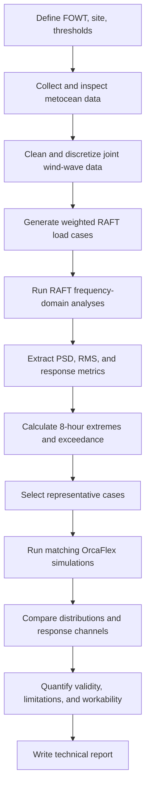

# FOWT Service Workability Course Workflow

This document turns the special-course description into an executable project workflow. The main objective is to estimate floating offshore wind turbine service workability with a fast frequency-domain model, then compare the results with time-domain reference simulations.

## 1. Project Objective

Build a reproducible pipeline that:

1. Converts site-specific joint wind-wave data into simulation cases.
2. Runs RAFT frequency-domain calculations for the selected FOWT.
3. Extracts motions, inclinations, and accelerations relevant to technician safety.
4. Calculates RMS values, short-term extremes, and threshold exceedance.
5. Compares RAFT results with OrcaFlex time-domain results.
6. Documents where the frequency-domain method is accurate enough for engineering use.

The final result should be a traceable chain from metocean input to a workability percentage and a discussion of model validity.

## 2. Recommended Repository Layout

Keep the original RAFT source and examples unchanged where possible. Add course-specific work in separate folders:

```text
RAFT/
├── designs/                         # Existing RAFT design files
├── examples/                        # Existing RAFT examples
├── raft/                            # RAFT source code; do not modify for analysis scripts
├── tests/                           # Existing RAFT regression tests
├── course_workflow/                 # New course analysis code
│   ├── config/
│   │   ├── project.yaml             # Paths, thresholds, service duration, conventions
│   │   └── cases.yaml               # Generated or selected environmental cases
│   ├── data/
│   │   ├── raw/                     # Original metocean and OrcaFlex files
│   │   ├── processed/               # Cleaned scatter tables and spectra
│   │   └── external/                # BEM, hydrodynamic, or turbine data
│   ├── scripts/
│   │   ├── 01_prepare_metocean.py
│   │   ├── 02_build_raft_cases.py
│   │   ├── 03_run_raft.py
│   │   ├── 04_postprocess_raft.py
│   │   ├── 05_compare_orcaflex.py
│   │   └── 06_make_report_figures.py
│   ├── results/
│   │   ├── metocean/
│   │   ├── raft/
│   │   ├── orcaflex/
│   │   ├── comparison/
│   │   └── figures/
│   └── README.md                    # Run instructions and data provenance
└── report/
    ├── figures/
    ├── tables/
    └── final_report.md              # Or the source file for the final PDF/report
```

Do not commit confidential or licensed OrcaFlex files. Store only file names, metadata, exported summary data, and scripts needed to reproduce the comparison.

## 3. End-to-End Flow



Each arrow should produce a saved file or table. Avoid relying on values that exist only in an interactive Python session.

## 4. What Calls What Inside RAFT

This section describes the current RAFT execution path. It is important to distinguish the RAFT solver from the course-specific processing that will be added around it.

### Single FOWT Path

The standard single-turbine path is:

```text
runRAFT(input_file)
    |
    +-- read YAML file with PyYAML
    +-- Model(design)
    |     +-- read settings and frequency grid
    |     +-- create one FOWT object
    |     +-- create turbine, platform, hydrodynamic, and mooring objects
    |
    +-- model.analyzeUnloaded()
    |     +-- calculate static properties
    |     +-- calculate hydrostatic and hydrodynamic properties
    |     +-- solve zero-load equilibrium
    |
    +-- model.solveEigen()
    |     +-- assemble mass and stiffness matrices
    |     +-- calculate natural frequencies and mode shapes
    |
    +-- model.analyzeCases()
          +-- prepare hydrodynamic/BEM data
          +-- loop through design['cases']['data']
          |     +-- solveStatics(case)
          |     +-- solveDynamics(case)
          |     +-- saveTurbineOutputs(...)
          +-- store results in model.results
```

The reference implementation for this path is `examples/example_from_yaml.py`. The model input is the complete YAML design, not just the environmental case. The environmental cases are read from the `cases.keys` and `cases.data` sections inside that design.

### Farm Path Used by `VolturnUS-S_farm.yaml`

For the farm file, use `runRAFTFarm(input_file)` or construct `Model(design)` and call `analyzeCases()`:

```text
runRAFTFarm('designs/VolturnUS-S_farm.yaml')
    |
    +-- read YAML file
    +-- Model(design)
    |     +-- detect the 'array' section
    |     +-- create one FOWT object for each array row
    |     +-- place each FOWT at x_location, y_location
    |     +-- create array-level MoorPy system if array_mooring exists
    |     +-- connect each FOWT to its turbine/platform/mooring ID
    |
    +-- model.analyzeCases()
          +-- calculate shared BEM/hydrodynamic data
          +-- loop through every case in cases.data
          |     +-- convert the row into a case dictionary
          |     +-- solveStatics(case)
          |     |     +-- calculate turbine mean loads
          |     |     +-- calculate current loads
          |     |     +-- solve platform and mooring equilibrium
          |     |     +-- store mean offsets
          |     |
          |     +-- solveDynamics(case)
          |     |     +-- calculate wave excitation
          |     |     +-- assemble mass, damping, and stiffness matrices
          |     |     +-- iterate the linearized frequency-domain response
          |     |     +-- calculate response amplitudes and PSDs
          |     |
          |     +-- saveTurbineOutputs(...) for each FOWT
          |           +-- calculate average values
          |           +-- calculate RMS values
          |           +-- calculate approximate max/min values
          |           +-- save PSDs and response amplitudes
          |
          +-- store results in model.results['case_metrics']
```

The farm runner deliberately does not use `analyzeUnloaded()` because the current farm implementation reports that unloaded analysis is not supported for the multi-turbine configuration. The first farm calculation therefore starts with the specified environmental cases.

### What Happens in `solveStatics(case)`

For each environmental case, RAFT first finds the mean operating position. It:

1. Checks whether `wind_speed` is one value or a list with one value per turbine.
2. Calculates turbine aerodynamic mean loads.
3. Calculates current loads from `current_speed` and `current_heading` when those fields exist.
4. Recalculates hydrostatic and mooring properties.
5. Solves for the equilibrium surge, sway, heave, roll, pitch, and yaw.
6. Stores the mean offset for the case.

If mooring-current modeling is enabled with `currentMod`, the current is also passed to the MoorPy mooring system. Otherwise, current loads can still be included on the FOWT hydrodynamic members, but mooring current effects are not enabled.

### What Happens in `solveDynamics(case)`

RAFT then calculates the fluctuating response around the mean position. The main inputs are the wave spectrum, wave height, wave period, wave heading, turbine properties, hydrodynamic coefficients, mooring stiffness, and aerodynamic linearization.

The solver works in the frequency domain. For every frequency in `settings.min_freq` to `settings.max_freq`, it solves for complex motion amplitudes. It iterates the response to update nonlinearized drag and other motion-dependent terms until the configured iteration limit is reached.

This produces response amplitudes for platform and turbine degrees of freedom. It does not produce a time history.

### What Happens in `saveTurbineOutputs(...)`

The response amplitudes are converted into quantities stored in `model.results`:

```text
model.results['case_metrics'][case_index][fowt_index]
    surge_avg, surge_std, surge_max, surge_min, surge_PSD
    sway_avg, sway_std, sway_max, sway_min, sway_PSD
    heave_avg, heave_std, heave_max, heave_min, heave_PSD
    roll_avg, roll_std, roll_max, roll_min, roll_PSD
    pitch_avg, pitch_std, pitch_max, pitch_min, pitch_PSD
    yaw_avg, yaw_std, yaw_max, yaw_min, yaw_PSD
    AxRNA_std, AxRNA_PSD
    AyRNA_std, AyRNA_PSD
    AzRNA_std, AzRNA_PSD
    Mbase_std, Mbase_PSD
```

The current RAFT maximum values are calculated approximately as mean plus or minus three standard deviations. The course workflow must add the service-duration extreme calculation and threshold pass/fail logic after RAFT returns these values.

### Where the Course Code Will Connect

The course-specific code should sit outside the RAFT solver:

```text
MESPAC hourly data
    --> metocean preprocessing
    --> weighted environmental case table
    --> RAFT YAML cases.data
    --> runRAFTFarm()
    --> model.results['case_metrics']
    --> RMS/extreme-value post-processing
    --> serviceability threshold checks
    --> weighted workability percentage
```

The first implementation should not modify `raft/raft_model.py`. It should create a separate runner that loads the validated farm YAML, replaces or generates `cases.data`, runs RAFT, and exports a compact result table.

### Optional FLORIS Wake Path

Wake coupling is a separate optional path and is not called by ordinary `analyzeCases()`:

```text
model.florisCoupling(...)
    --> initialize FLORIS and update turbine layout

model.florisFindEquilibrium(case, ...)
    --> calculate wake-reduced wind speed at each turbine
    --> update case['wind_speed'] with one value per turbine

model.analyzeCases()
    --> use those turbine-specific wind speeds in the RAFT calculation
```

For the course, first establish the no-wake baseline. Then compare it with a wake case using the same wave and current conditions. Record the wind speed received by every turbine so that any serviceability difference can be traced to the wake calculation.

## 5. Phase-by-Phase Workflow

### Phase 1: Literature Review and Setup

**Where:** `docs/`, `course_workflow/config/`, `course_workflow/README.md`

**Do:**

- Define the service task and the technician location on the FOWT.
- Define response channels, for example platform roll, pitch, tower-top acceleration, and local technician-point acceleration.
- Collect the workability thresholds and record their units and source.
- Select one baseline RAFT design, initially `designs/VolturnUS-S.yaml` or an equivalent validated design.
- Record coordinate systems, sign conventions, heading conventions, and reference points.
- Confirm the RAFT environment by running the existing tests before adding course code.

**Deliverables:**

- `course_workflow/config/project.yaml`
- A one-page assumptions and data-provenance note.
- A baseline RAFT run that completes without course-specific changes.

**Gate:** Do not start metocean processing until the baseline design, units, and response channels are documented.

### Phase 2: Metocean Pre-processing

**Where:** `course_workflow/scripts/01_prepare_metocean.py`, `course_workflow/data/raw/`, `course_workflow/data/processed/`

**Do:**

- Import the joint wind-wave scatter data and preserve the original file.
- Check missing values, impossible values, units, headings, and bin definitions.
- Define the environmental variables needed by RAFT: wind speed, wind heading, wave spectrum, wave height, wave period, wave heading, and current if available.
- Choose a reduction strategy that keeps the dominant probability mass and physically important sea states.
- Assign each retained case a probability weight and retain the sum of all discarded probability.
- Generate a machine-readable case table with a stable case ID.

**Minimum output columns:**

```text
case_id, probability, wind_speed, wind_heading, wave_spectrum,
wave_height, wave_period, wave_heading, current_speed, current_heading
```

**Deliverables:**

- Cleaned scatter table.
- Case-reduction explanation.
- Plot of the original and retained joint distributions.
- Validation report showing that probabilities sum to one, within the stated treatment of discarded bins.

**Gate:** The case table must be independently readable and auditable before it is converted into RAFT YAML.

### Phase 3: Frequency-Domain RAFT Modeling

**Where:** `course_workflow/scripts/02_build_raft_cases.py`, `course_workflow/scripts/03_run_raft.py`, `course_workflow/results/raft/`

**Do:**

- Start from a known-good RAFT design YAML rather than constructing the full turbine and platform model from scratch.
- Generate one RAFT case or a controlled batch of cases from the processed metocean table.
- Keep the RAFT frequency range and frequency resolution in `settings` documented. Check that the frequency resolution is adequate for the expected platform modes and wave spectra.
- Run the standard RAFT sequence:

```python
model = raft.Model(design)
model.analyzeUnloaded()
model.solveEigen()
model.analyzeCases()
```

- Save the input YAML, case ID, software version, run timestamp, warnings, and results for every run.
- Use the existing `examples/example_from_yaml.py` as the first implementation reference.

**Key RAFT outputs:**

- Natural frequencies and mode shapes.
- Mean offsets and static properties.
- Response power spectral densities.
- Case metrics stored in `model.results`.
- Response plots for selected cases.

**Deliverables:**

- Reproducible RAFT runner.
- One result file per case or a clearly indexed result database.
- QA table showing completed, failed, and skipped cases.

**Gate:** Run a small test batch first. Inspect at least one PSD and one response summary manually before running the full case set.

### Phase 4: Response Post-processing and Workability Statistics

**Where:** `course_workflow/scripts/04_postprocess_raft.py`, `course_workflow/results/raft/`, `course_workflow/results/comparison/`

**Do:**

- Map RAFT response channels to engineering quantities and technician locations.
- For a response PSD $S_x(f)$, calculate RMS using:

$$
\sigma_x = \sqrt{\int_0^\infty S_x(f)\,df}
$$

- Estimate short-term extremes for an 8-hour service window using a documented narrow-band or spectral extreme model.
- Record the assumptions for zero-crossing frequency, bandwidth, stationarity, and Gaussian response behavior.
- Compare each response with the selected threshold.
- Calculate per-case exceedance indicators and weighted workability.

A basic weighted workability estimate is:

$$
W = \sum_i p_i I_i,
$$

where $p_i$ is the probability of environmental case $i$ and $I_i=1$ only when every required service criterion is satisfied.

**Deliverables:**

- Case-level table containing RMS, estimated extreme, threshold, margin, and pass/fail for every channel.
- Weighted workability percentage.
- Sensitivity results for service duration and threshold assumptions.
- Plots of response spectra, RMS versus sea state, and exceedance probability.

**Gate:** Confirm units and response definitions with hand calculations for at least one case. A plausible-looking percentage is not sufficient evidence of correctness.

### Phase 5: OrcaFlex Benchmarking

**Where:** `course_workflow/scripts/05_compare_orcaflex.py`, `course_workflow/data/raw/`, `course_workflow/results/orcaflex/`, `course_workflow/results/comparison/`

**Do:**

- Select representative cases rather than attempting to run the entire scatter table immediately. Include low, medium, high, and near-threshold conditions.
- Match RAFT and OrcaFlex inputs as closely as possible: turbine operating state, wind and wave headings, wave spectrum, significant wave height, peak period, water depth, and analysis duration.
- Use the same output reference points, coordinate conventions, sampling assumptions, and response channels.
- Remove transients consistently before calculating time-domain statistics.
- Calculate OrcaFlex RMS, maxima, and exceedance metrics using the same definitions used for RAFT.
- Measure both agreement and computational cost.

**Comparison table:**

```text
case_id, channel, raft_rms, orcaflex_rms, rms_relative_error,
raft_extreme, orcaflex_extreme, extreme_relative_error,
raft_runtime, orcaflex_runtime, notes
```

**Deliverables:**

- Matched-input table.
- Time-series and PSD comparison plots.
- Error summary by channel and sea state.
- Explanation of disagreements, such as nonlinear effects, damping, controller behavior, mooring model differences, or finite-duration sampling.

**Gate:** Do not describe RAFT as validated based on one matching case. State the range of conditions and channels for which the comparison supports the conclusion.

### Phase 6: Final Technical Report

**Where:** `report/`

Use this report structure:

1. **Introduction and research question**
2. **System, site, and service operation**
3. **Metocean data and case reduction**
4. **RAFT frequency-domain methodology**
5. **Workability criteria and short-term statistics**
6. **OrcaFlex benchmark methodology**
7. **Results and validation**
8. **Sensitivity and uncertainty analysis**
9. **Engineering applicability and limitations**
10. **Conclusions and recommendations**
11. **Reproducibility appendix**

Every major figure and table should identify its source script, input data, case IDs, and units.

## 6. Suggested 13-Week Schedule

| Week | Main activity | Concrete output |
| --- | --- | --- |
| 1 | Literature, scope, environment | Assumptions and baseline design |
| 2 | RAFT familiarization and tests | Verified baseline run |
| 3 | Metocean inspection | Raw-data assessment |
| 4 | Case discretization | Processed weighted case table |
| 5 | RAFT case generation | Automated YAML generation |
| 6 | RAFT batch execution | Complete first result batch |
| 7 | RAFT QA and response extraction | Clean response database |
| 8 | RMS and extreme statistics | Workability calculation |
| 9 | OrcaFlex case selection and setup | Matched benchmark cases |
| 10 | OrcaFlex simulations | Exported time histories and summaries |
| 11 | Comparison and sensitivity | Error and runtime analysis |
| 12 | Report figures and interpretation | Draft results and discussion |
| 13 | Final report and reproducibility check | Submitted report and runnable workflow |

## 7. Definition of Done

The project is complete when:

- A new user can identify the source data, configuration, and command for each result.
- The metocean case probabilities and reduction method are documented.
- RAFT results exist for all retained cases, with failed cases explicitly reported.
- Workability criteria are applied consistently across RAFT and OrcaFlex.
- At least one independent check supports the RMS and extreme-value calculations.
- RAFT and OrcaFlex are compared for multiple representative conditions and response channels.
- Runtime, accuracy, and limitations are discussed together.
- The final report can be regenerated from the saved scripts and configuration without modifying RAFT source code.

## 8. First Actions

1. Create `course_workflow/` using the layout above.
2. Copy one validated design into the workflow configuration by reference; do not duplicate large YAML sections unnecessarily.
3. Create `project.yaml` with service duration, thresholds, response channels, units, and source-data paths.
4. Run the existing RAFT example and relevant tests.
5. Prepare a small five-to-ten-case metocean table manually.
6. Run those cases through RAFT before automating the full scatter-data pipeline.
7. Only after the small batch passes inspection, implement weighted workability and OrcaFlex benchmarking.

## 9. Repository Workflow: Which File Does What?

This is the practical map of the repository for this project. Start with the input YAML, follow the call into the RAFT model, and inspect the results returned by the model. The course-specific preprocessing and serviceability code should be added outside the existing RAFT solver.

### Main Starting Point for the Farm

For the current project, the main input file is:

```text
designs/VolturnUS-S_farm.yaml
```

It contains the complete model definition:

- `settings`: frequency range and solver iteration settings.
- `site`: water depth, fluid properties, and wind shear.
- `cases`: wind, wave, and later current environmental cases.
- `array`: number, IDs, positions, and headings of the turbines.
- `array_mooring`: optional shared array mooring input.
- `turbine`: turbine, rotor, aerodynamic, and controller data.
- `platform`: tower and platform geometry, mass, drag, and hydrodynamic data.
- `mooring`: mooring points, lines, line types, and anchor data.

The active file currently has two active array rows. The four-turbine layout is present as commented example rows, so those rows must be uncommented and checked if a four-turbine case is required.

### Execution Order for the Existing Repository

```text
designs/VolturnUS-S_farm.yaml
        |
        v
raft/runRAFT.py
        |
        +-- runRAFTFarm(input_file)
        |       |
        |       +-- reads the YAML file
        |       +-- creates raft.Model(design)
        |       +-- calls model.analyzeCases()
        |       +-- optionally plots responses
        |
        v
raft/raft_model.py
        |
        +-- Model.__init__()
        |       +-- reads settings and site data
        |       +-- creates one FOWT per array row
        |       +-- creates the array MoorPy system
        |       +-- connects turbine, platform, and mooring definitions
        |
        +-- Model.analyzeCases()
        |       +-- prepares BEM/hydrodynamic data
        |       +-- loops over cases.data
        |       +-- calls solveStatics(case)
        |       +-- calls solveDynamics(case)
        |       +-- calls FOWT.saveTurbineOutputs(...)
        |
        v
raft/raft_fowt.py
        |
        +-- calculates one floating turbine's static properties
        +-- calculates hydrodynamic excitation and response
        +-- calculates platform motions and accelerations
        +-- calculates mooring and tower-base response quantities
        +-- stores metrics returned to raft_model.py
        |
        v
model.results['case_metrics']
```

### Important Existing Files

| File or folder | Purpose in the workflow |
| --- | --- |
| `designs/VolturnUS-S_farm.yaml` | Complete two- or four-turbine farm input for this project. |
| `designs/VolturnUS-S.yaml` | Single-FOWT version useful for first debugging and baseline checks. |
| `examples/example_from_yaml.py` | Simple reference showing how to load YAML, create a model, analyze it, and plot results. |
| `raft/__init__.py` | Exposes `raft.Model` by importing it from `raft_model.py`. |
| `raft/raft_model.py` | Main orchestration file. It creates the model, runs cases, solves statics and dynamics, and stores results. |
| `raft/raft_fowt.py` | Implements the physical FOWT calculations for turbine, platform, hydrodynamics, response, accelerations, and output metrics. |
| `raft/raft_rotor.py` | Implements rotor and aerodynamic calculations used by each FOWT. |
| `raft/raft_member.py` | Represents structural and hydrodynamic members such as tower and platform members. |
| `raft/raft_node.py` | Represents structural nodes and their degrees of freedom. |
| `raft/helpers.py` | Shared numerical, spectral, coordinate, and response helper functions. |
| `raft/IntersectionMesh.py` and `raft/member2pnl.py` | Mesh and panel-related utilities used for hydrodynamic/BEM preparation. |
| `examples/` | Small runnable examples and example input files. |
| `tests/` | Regression tests and reference results used to check RAFT calculations. |
| `docs/usage.rst` | General RAFT input format and solver workflow documentation. |
| `docs/course_workflow.md` | This project-specific plan, including the future metocean and serviceability workflow. |

### What Happens in Each Main RAFT File

`raft/raft_model.py` is the coordinator. It does not define every physical calculation itself. Instead, it creates the FOWT objects and calls their methods in the correct order. For every case, its central sequence is:

```text
Model.analyzeCases()
    -> Model.solveStatics(case)
    -> Model.solveDynamics(case)
    -> FOWT.saveTurbineOutputs(results, case)
```

`raft/raft_fowt.py` is where the response of each individual floating turbine is computed. It receives the environmental case and model state from `raft_model.py`, calculates hydrodynamic and aerodynamic quantities, solves the frequency-domain motion response, and returns quantities such as platform pitch, roll, nacelle acceleration, and mooring tension.

`examples/example_from_yaml.py` is not the solver itself. It is only a small driver script. It demonstrates the normal single-FOWT order:

```text
load YAML
    -> raft.Model(design)
    -> analyzeUnloaded()
    -> solveEigen()
    -> analyzeCases()
    -> plotResponses()
```

For the farm case, use the farm runner path because multi-turbine farms have different initialization limitations. The `raft/runRAFT.py` file contains the `runRAFTFarm()` convenience function, but its farm call is currently commented out in the `__main__` example. That function can be called from a separate script without modifying the RAFT source.

### Where New Course Files Belong

The new course files should wrap the existing repository in this order:

```text
course_workflow/data/raw/
    original MESPAC exports
        |
course_workflow/scripts/01_prepare_metocean.py
    clean data and calculate case probabilities
        |
course_workflow/scripts/02_build_raft_cases.py
    create the cases section used by the farm YAML
        |
course_workflow/scripts/03_run_raft.py
    call raft.Model(...) and model.analyzeCases()
        |
course_workflow/scripts/04_postprocess_raft.py
    read model.results['case_metrics']
        |
course_workflow/scripts/05_check_serviceability.py
    apply inclination, acceleration, and other thresholds
        |
course_workflow/results/
    case results, pass/fail decisions, and weighted workability
```

The first course script should therefore be a small RAFT runner and result exporter, not a modification to `raft/raft_model.py`. Once that runner works for the existing single case in `VolturnUS-S_farm.yaml`, add more environmental cases and then connect the MESPAC preprocessing.